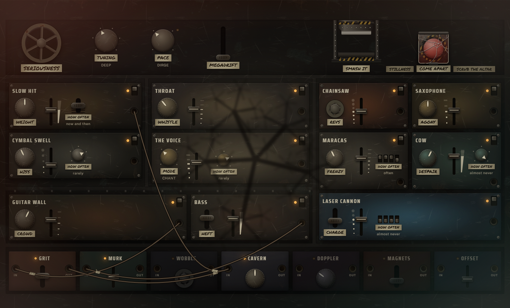
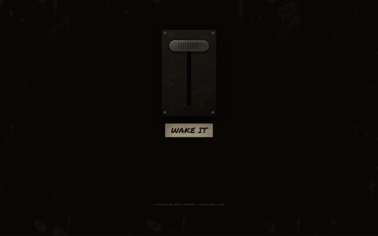

# Drone Engine

A drone-metal generator in your browser, drawn as a scavenged, half-broken control
board. Pull the lever and it is already playing. Turn things, and an endless slab of
doom builds itself.

It is for people who are not musicians. There is one root note, nothing has to be in
time with anything, and no combination of settings sounds wrong. Only heavier.

**[Play it in your browser](https://thomasw.cool/play/drone-engine/)** — turn your
volume down first, and read the warning below.



> [!WARNING]
> **It starts loud, and it flashes.** Turn your volume down before you pull the
> lever. Hits bloom with light. The hard flashing is a strobe, never faster than
> three times a second, and it stays off until you lift the cover on COME APART and
> press the button. STILLNESS stops everything on the board from moving, and the
> board opens that way if your system asks for reduced motion.

## What is on it

- **Eleven things that make noise**, all synthesised: GUITAR WALL, BASS, CHAINSAW,
  SAXOPHONE, THROAT, SLOW HIT, CYMBAL SWELL, THE VOICE, MARACAS, COW and LASER
  CANNON.
- **Seven boxes to run them through**, patched with cables you drag from socket to
  socket: GRIT, MURK, WOBBLE, CAVERN, DOPPLER, MAGNETS and OFFSET.
- **SERIOUSNESS**, the big wheel. Turn it up and everything sinks in pitch and the
  room gets longer. At the top, the cow is a problem.
- **SMASH IT**, a drop hammer. It breaks everything and starts again.
- **A board that rusts while it runs** and wears where you touch it. SCRUB THE ALTAR
  makes it look new.

Nothing is labelled with what it technically is. Hover over a control and it says
what it does in plain words.



## Run it

You need [Node.js](https://nodejs.org) 22 or newer.

```
git clone https://github.com/thomas-whitaker1/drone-engine
cd drone-engine
npm install
npm run dev
```

Or take `drone-engine-1.0.0.zip` from the
[releases page](https://github.com/thomas-whitaker1/drone-engine/releases), unzip it
and put the folder behind any static web server. It will not run from a
double-clicked file: the script is an ES module, and browsers refuse those over
`file://`.

`npm run build` makes that same folder in `dist/`: one page, one script of about
58 kB gzipped, four typefaces and their licences. Every address in it is relative, so
it runs from a domain root or from a subfolder.

## Where it works

It is built for a desktop browser and a mouse. It has been tested in Chrome and
Firefox on Windows; Edge shares Chrome's engine. Safari has not been tested.

There is no phone layout. On a narrow screen the whole board scales down to fit,
which leaves it too small to use, and it says so before you pull the lever.

## How it is made

- **Everything is synthesised in Web Audio.** No samples, no audio files, and no
  runtime dependencies.
- **Nothing is random while it plays.** The same settings make the same sound. The
  hammer is the only thing that rolls dice.
- **The page asks the network for nothing** but its own folder. The fonts are in the
  repository.
- **About 1,360 tests.** One suite renders the real engine in a real headless
  browser and measures what comes out; it uses the Chrome or Edge already on your
  machine and skips itself if there is none.

```
npm run typecheck   # tsc
npm test            # vitest
npm run build       # typecheck, then build into dist/
npm run preview     # serve dist/
```

[`CLAUDE.md`](CLAUDE.md) has the rules the board is held to, where things live and
how to work on it; it is written for a coding agent and reads fine without one.
`tools/perf/` holds the scripts that time the board in a real browser.

A `gt#42` in a comment or a test title is issue 42 in a private tracker this
repository does not have. The comment says what matters; the number is only where
the argument was had.

## Typefaces

Permanent Marker (Font Diner, Apache License 2.0), and Public Sans, Saira Condensed
and Stardos Stencil (SIL Open Font License 1.1). The licence texts are in
[`src/fonts/licenses`](src/fonts/licenses) and go out with every build.

## License

MIT. See [`LICENSE`](LICENSE).
